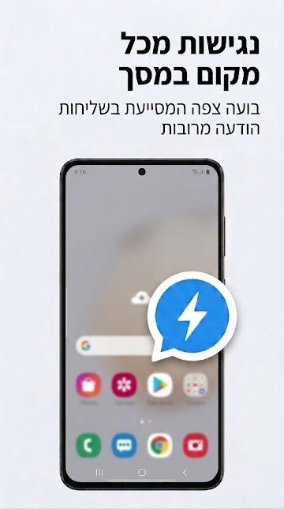
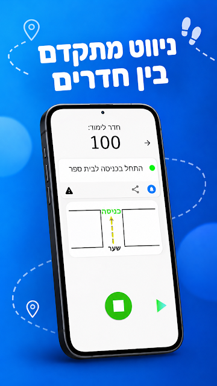
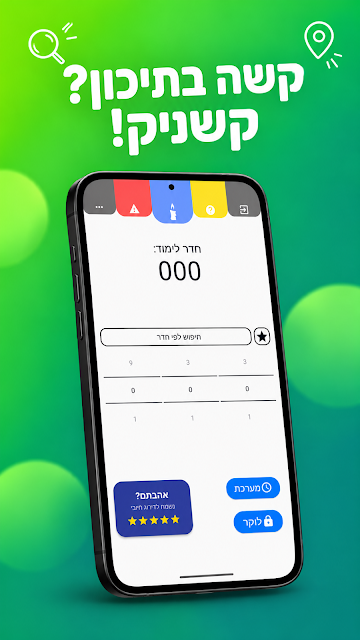

# Hey, I'm Dotan 👋
### Full-Stack Developer | Python & Node.js 

I like building things from scratch — whether it's a web app, a mobile app,
a game, or something that scrapes the internet at 2am for no good reason.

My stack spans the full product: frontend to backend, databases to
deployment. I've also built mobile applications (that are currently published on Google Play), and lately I've been
going deep on Python — LLMs, AI, web scraping, computer vision, and
whatever interesting problem shows up next.

🥋 Before code, there was judo — I'm a former **Israeli National Judo Team** athlete
(Israeli Champion, competed in Europe). I learned to code between training sessions,
and the same discipline carried over: show up every day, get a little better.

<!-- I care about clean code and solid architecture. Not because someone
told me to, but because I've read enough messy code to know the difference. -->

> Most of my projects are private for now — they'll go public when
> they're ready. I'm not in a rush, I'm in a process. 🚧

---

## ⭐ Featured Projects

### [AllyCat](https://www.npmjs.com/package/allycat) — Accessibility CLI Analyzer
> Source-first accessibility analyzer for the web — built for developers, not auditors.

  

- **2,500+ npm downloads** — 1,000+ of them in the first 1.5 weeks after launch
- Scans JSX/TSX, Vue, Angular & HTML **without a running server** — exact line numbers, zero build tools required
- `allycat fix` hands the found issues straight to **Claude Code** in a new terminal to fix them
- Watch mode, `--baseline` flag, CI gates, WCAG 2.1 / 2.2 AA via axe-core
- CI on Ubuntu / macOS / Windows with GitHub Actions, published with npm Trusted Publishing
- Built with Node.js, Playwright, JSDOM, Babel, Chokidar, ESM
- Open source under the **[AllyCatHQ](https://github.com/AllyCatHQ)** GitHub org

### [Dotmarket](https://github.com/dotcomico/dotmarket) — Full-Stack Supermarket + AI Assistant
> A full online supermarket: a customer storefront and a complete admin back office.

<table>
<tr>
<td width="50%"></td>
<td width="50%"></td>
</tr>
<tr>
<td align="center"><b>Storefront</b> — cart & checkout</td>
<td align="center"><b>Admin</b> — product management</td>
</tr>
</table>

- **React 19 + TypeScript** frontend (Vite, Zustand, React Router 7)
- **Flask REST API** — layered routes → services → models, JWT auth + role-based access
- **AI chat assistant** — a FastAPI service runs an LLM (local Ollama) that calls an **MCP server** to answer with real product data
- Runs as a 6-service **Docker Compose** stack behind an nginx reverse proxy
- Repos: [workspace](https://github.com/dotcomico/dotmarket) · [client](https://github.com/dotcomico/dotmarket-client) · [server](https://github.com/dotcomico/dotmarket-server)

---

## 📱 Live on Google Play

<table>
<tr>
<td width="50%" valign="top">
<h3> <a href="https://play.google.com/store/apps/details?id=com.dotcom.quicksendwhatsapp">Quick Send – Direct Chat</a></h3>

  
Send a WhatsApp message to a number without saving it as a contact.
  

 
Floating widget (Foreground Service) · WhatsApp Business support · message history & templates · EN/HE · dark mode
 
<b>Java · Android · Material Design 3</b> · 100+ downloads
</td>
<td width="50%" valign="top">
<h3> <a href="https://play.google.com/store/apps/details?id=com.myappname.kashniks">Kashnik</a></h3>

  
An indoor guide for Kiryat Sharet High School (Holon), used by real students.
  

 
~44 rooms mapped by hand with annotated photo directions · weekly class schedule · encrypted locker codes · Hebrew UI
 
<b>Java · Android · Material Design 3</b> · 50+ downloads
</td>
</tr>
</table>

---

## 🧪 More Public Projects

### [Crypto Tracker](https://github.com/dotcomico/crypto)

Live prices for the top 100 coins in USD / EUR / ILS, search, and a personal 5-coin watchlist. Vanilla JavaScript (ES modules), jQuery and Bootstrap 5 on the CoinGecko API, with client-side caching to keep API calls low.

### [Sticky Notes Todo](https://github.com/dotcomico/sticky-notes-todo)

A task board that looks like a corkboard covered in sticky notes. Plain HTML, CSS and JavaScript — no frameworks, no build step.

---

## 🛠️ My Tech Stack

### Frontend & UI

### Backend

### AI & LLMs

### Python Ecosystem

*Also worked with: OpenCV, Pandas, Selenium, MediaPipe, BeautifulSoup, Scrapy, LangChain, OpenAI API, WebSockets, WhatsApp Bots*

### Databases

### Mobile & Game Dev

### Tools & DevOps

---
<!-- 
## 🧠 Development Philosophy

I don't just write features — I stress-test them. My default mindset is
**"what could go wrong here?"**, which means separate test suites for edge
cases, not just the happy path.

- **Modular by default** — components and modules that don't fight each other
- **Edge case first** — null values, overflows, unexpected inputs are features, not surprises
- **Clean > clever** — if it needs a comment to explain what it does, it needs a rewrite

---
 -->
## 📊 GitHub Stats
*(Most of my work lives in private repos — these numbers are just the tip)*

  
  

---
## 📫 Let's Connect!

